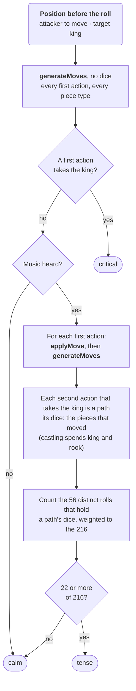

The music follows the danger to a king ([#76](https://github.com/fortemate/dicechess-tv/issues/76)): a calm, a tense or a critical theme over a game ([Sound](/design/sound/#music-that-follows-the-danger)). This page sets out how that level is measured, at the start of every turn, in `src/core/danger.ts`. The level has one other listener: the computer opponent's threat line, said once a game on a critical turn.

## The three levels

The level is measured for the side about to roll, against one king, from the position before the roll:

| Level    | When                                                                              |
| -------- | --------------------------------------------------------------------------------- |
| Critical | Some roll lets that side take the king with its first action.                     |
| Tense    | At least 22 of the 216 rolls (6 × 6 × 6) let it take the king within two actions. |
| Calm     | Neither.                                                                          |

Twenty-two is just over a tenth of the rolls. Any roll at all would do in a crowded middle game nearly every turn, and music that is always tense is not tense.

The measure uses the engine's pseudo-legal moves rather than the legal turn tree. A path that takes the king is legal whatever the rule of using as many dice as possible says, since taking the king ends the turn and the game. The tests check the counts against the legal turn tree.

## Whose king, from which position

| Game                     | Turn starting   | What is measured                                                        |
| ------------------------ | --------------- | ----------------------------------------------------------------------- |
| Against the computer     | The computer's  | Its threat to your king now.                                            |
| Against the computer     | Yours           | Its threat on its next turn, as if you passed (the engine's `endTurn`). |
| Play a friend (Hot Seat) | Either player's | The greater threat to either king.                                      |

Against the computer the music says "your king", never "a king": a threat you make is not news to you.

## How tense is counted

The engine gives the moves of every piece type at once for a position without dice. So the two actions are searched once for all the rolls, not once for each roll. Each path that takes the king notes the dice it spends: a die for its piece, and a rook's die as well when the king castles. A roll that holds those dice can play the path, so the last step counts the distinct rolls that hold the dice of some path.

How many of the 216 rolls hold a path's dice depends only on those dice:

| A path's dice                  | Rolls that hold them |
| ------------------------------ | -------------------: |
| One piece (critical)           |                   91 |
| Two different pieces           |                   30 |
| The same piece twice           |                   16 |
| A castling, then a third piece |                    6 |

So a single path with two different pieces is enough for tense, and one piece moving twice is not. When several paths need different dice, the rolls that hold any of them are counted once each.

Without music the measure stops after the first step: one move generation tells critical from calm, which is all the threat line needs ([#368](https://github.com/fortemate/dicechess-tv/issues/368)). In a Hot Seat game without music nothing listens, so nothing is measured.

### A worked example

Black to move, `3rkb2/ppp3pp/3p2N1/4PP2/8/8/PPPK1PPP/RN5R b - - 1 7`, against the White king on d2. The rook on d8 looks down the d-file, but Black's own pawn on d6 stands in the way.

1. No first action reaches d2, so the level is not critical.
2. Of Black's 19 first actions, one opens the file: the pawn takes on e5 (`d6e5`). After it, the rook takes the king (`d8d2`).
3. That path spends a pawn die and a rook die. 30 of the 216 rolls show both.
4. 30 is 22 or more: **tense**.

On a board where a rook can reach the king only by moving twice, the path spends two rook dice. Only 16 rolls show them, so the level stays calm unless another path adds rolls.

## When it runs

Once per turn, in one slot of the app's background scheduler (`native/src/useDanger.ts`) after the frame that shows the new turn. Nothing is worked out while the turn is played, so the remote never waits for it. A new turn or leaving the game drops a measure that has not run yet. Behind a system overlay or in the background it waits, and it runs on the return.

The music then settles: it rises at once to a higher level, because a threat is news, and falls one level per turn, so one quiet turn does not drop a tense game to calm.

## What two actions leave out

Until 13 October 2026 tense looked three actions deep, and each of the 56 distinct rolls was searched on its own. That was thousands of engine calls a turn, and on a Fire TV Stick each roll's search held the JavaScript thread for up to 2.7 s, so the cursor waited for it ([Performance](/technology/performance/#danger-evaluation--threat-analysis), [#365](https://github.com/fortemate/dicechess-tv/issues/365)). The owner chose two actions: in seeded games, 9 of 300 turns that three actions heard as tense are calm now. An exact three-action measure computed inside the engine is planned in [#382](https://github.com/fortemate/dicechess-tv/issues/382).

## Sources and validation

- `src/core/danger.ts`: the measure. `native/src/useDanger.ts`: when it runs, and how the level settles.
- `test/danger.test.ts` checks the first-action and two-action counts of fixed positions against the engine's legal turn tree. On 200 positions from seeded games it checks them against a search of each roll on its own. It also checks that a measure goes no deeper than one action.
- `native/test/useDanger.test.tsx` checks the single slot, pausing, a replaced position, an engine fault heard as calm, and the behaviour without music.
- Figures from Node and from a Fire TV Stick are on the [Performance](/technology/performance/#danger-evaluation--threat-analysis) page.
