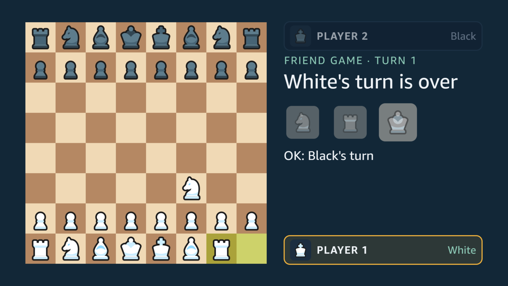
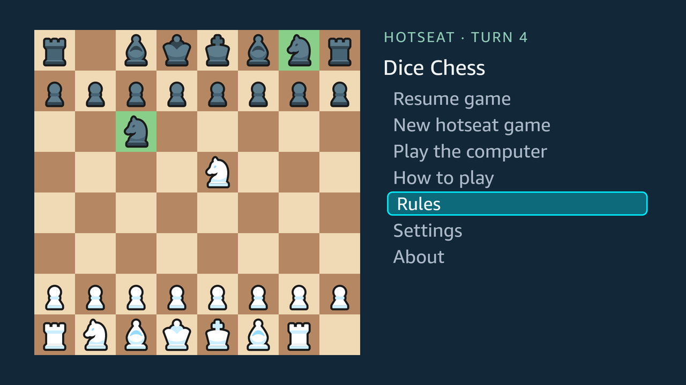

A television is read from three metres away, often by several people at once, and it may crop the edges of the picture. Everything on the screen is sized and placed for that.

## The board

The squares use the brown palette of Chessground, the board of the open-source chess site Lichess, which many players already know. Each mark on the board looks different, not only a different colour:

| Mark                  | How it looks                                                        |
| --------------------- | ------------------------------------------------------------------- |
| The cursor            | A cyan frame around the square                                      |
| A piece that can move | A translucent green fill                                            |
| The piece in hand     | A translucent cyan fill                                             |
| A destination         | A dot on an empty square; a ring around a piece that would be taken |
| The last move         | A translucent yellow-green tint on both of its squares              |

A dot covers 32 % of its square, and a capture ring 94 %, drawn under the piece so that it does not cover the piece's edges.

## The dice

The roll is drawn as three dice, as the other Dice Chess clients draw it. Each face shows the piece it allows, in the colour of the side to move. The state of each die shows in more than its colour:

- **A die still to play** carries a cyan ring.
- **A spent die** fades to 30 % and shrinks.
- **A die no legal turn can use** loses its ring and fades to 45 %, but keeps its size: it will not be played. It dims as soon as that is known, at the roll or after an action, and not only once the turn is over. In the opening with queen, bishop and knight, only a knight can move, and no knight move frees the bishop or the queen, so both of those dice dim at the roll.

A roll tumbles in: each die turns onto its face, and the three land lit in about a quarter of a second. A die that no legal turn can use dims as it lands.

Before the first roll of a game the three places show empty outlines. After that the last dice played stay on screen, as they ended and in the colour of the side that rolled them, until the person's OK throws new ones. So after the computer's turn, which plays out quickly, its roll can still be read ([#298](https://github.com/fortemate/dicechess-tv/pull/298)); the app's tests check it.

## Sizes and the safe area

The app lays out a 960 x 540 dp screen, which is how a 1920 x 1080 television reports itself.

- **Text.** The headline is 38 dp, and no text is smaller than 20 dp: that is the minimum the React Native TV guide by Amazon and Callstack recommends, above Amazon's own 14sp.
- **The safe area.** Nothing sits in the outer 5 % of any edge (48 dp across, 27 dp down), where a television may crop. The board is 460 dp, and it leaves a 372 dp panel beside it, wide enough for the longest headline on one line.
- **Evidence.** Each screen was checked on the Vega Virtual Device: a script counted anything but the background inside that margin, and found nothing.

## Focus

- **Focus.** A focused menu item or rules topic is framed and filled, not only coloured.
- **Press.** While OK is held down, the item fills more strongly and shrinks a little, so the press shows before its choice takes effect.
- **Wrapping.** The text sits inside the frame, so a long title that wraps keeps its second line under its first.

## Colour-blind viewers

The marks were checked by simulating colour-vision deficiency on the board's own colours, for this page:

- the Machado, Oliveira and Fernandes (2009) model;
- differences measured in OKLab, ×100, each overlay blended over the square it sits on;
- read by the usual thresholds: 8 or more tells two colours apart, 6 to 8 only with a second cue, and under 6 does not.

| Pair                                | Normal vision | Protanopia | Deuteranopia | Tritanopia |
| ----------------------------------- | ------------: | ---------: | -----------: | ---------: |
| Green fill vs plain dark square     |          12.8 |        5.9 |      **0.3** |       14.7 |
| Green fill vs plain light square    |          15.1 |        7.5 |         10.8 |       16.1 |
| Green fill vs last-move tint, light |           8.6 |        5.0 |          7.4 |       10.7 |
| Green fill vs last-move tint, dark  |           8.1 |        4.2 |          6.1 |       10.5 |

Most marks in the default **Standard** style already have a second cue: destinations are dots or rings, the dice differ by ring and size, and the cursor and the focus are frames. The green fill for a piece that can move is the exception — for a deuteranope it all but disappears on dark squares, and even with normal vision it sits close to the last-move tint — and when a piece is picked up, its square and the cursor square both carry a cyan perimeter frame. The same concern retired an earlier amber mark ([Designing for the remote](/design/remote/)).

**Highlights** in Settings ([pull request 413](https://github.com/fortemate/dicechess-tv/pull/413)) offers four board-highlight styles so players can keep the default television look or switch to stronger separation, a colour-vision-safe palette, or monochrome high contrast:

| Style             | Palette         | Movable pieces                     | Picked-up piece                                     | Destinations                                    | Destination under cursor            | Cursor                          | Last move         |
| ----------------- | --------------- | ---------------------------------- | --------------------------------------------------- | ----------------------------------------------- | ----------------------------------- | ------------------------------- | ----------------- |
| **Standard**      | TV (`theme.ts`) | Translucent green fill             | Translucent cyan fill + double-width cyan frame     | Green dot or capture ring                       | Cursor frame alone                  | Cyan perimeter frame            | Yellow-green tint |
| **Enhanced**      | TV (`theme.ts`) | Translucent green fill             | Lifted piece (`1.18x`) over a soft oval drop shadow | Green dot or capture ring                       | Cursor frame alone                  | Bold two-tone frame (cyan/ink)  | Yellow-green tint |
| **Colour-blind**  | Okabe–Ito       | Blue fill (`#0072b2`) + 4 corners  | Lifted piece + reddish-purple pedestal (`#cc79a7`)  | Vermilion dot/ring (`#d55e00`) with white rim   | Semi-transparent ghost of the piece | Bold two-tone frame (`#f0e442`) | Sky-blue inset    |
| **High contrast** | Black & white   | Black corner triangles (`#000000`) | Lifted piece (`1.18x`) over a dark oval drop shadow | Black dot/ring (`#000000`) with crisp white rim | Semi-transparent ghost of the piece | White wash + two-tone frame     | White inset frame |

In **Enhanced**, **Colour-blind** and **High contrast**, the picked-up piece never uses a perimeter border, so the cursor is the only perimeter frame on the board when choosing a destination. In **Colour-blind** and **High contrast**, every board state is distinguished by shape as well as colour: corner triangles for pieces that can move, a lifted piece (and pedestal in **Colour-blind**) for the piece in hand, white-rimmed dots and double-rimmed capture rings for destinations, a ghost preview of the carried piece under the cursor, a two-tone cursor frame that contrasts against both light and dark squares, and an inset outline for the last move that sits inside both bands of the cursor frame.

The styles were evaluated side by side on the browser test bench ([`web/`](https://github.com/fortemate/dicechess-tv/tree/main/web), [pull request 402](https://github.com/fortemate/dicechess-tv/pull/402)) across Step 1 (choosing a piece) and Step 2 (choosing a destination on light and dark empty and capture squares) under the Machado dichromacy and achromatopsia filters, covered by `native/test/highlights.test.tsx`, and installed and launched on a physical Fire TV Stick 4K Select (build 32, 17 October 2026).

## Sources

- `native/src/theme.ts`: the default television colours.
- `native/src/highlightsSetting.ts` and `native/src/Square.tsx`: the four highlight styles and their geometry, tested in `native/test/highlights.test.tsx`.
